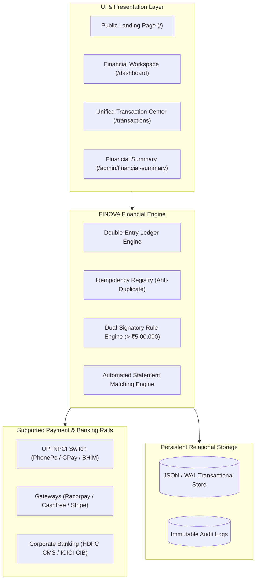

# FINOVA — Enterprise Payment & Financial Operations Platform

> **All Your Payments. One Clear View.**  
> A production-grade, responsive, all-in-one payment management and financial operations console inspired by modern banking, UPI switches, and enterprise treasury systems.

[](https://nextjs.org/)
[](https://react.dev/)
[](https://www.typescriptlang.org/)
[](https://tailwindcss.com/)
[](LICENSE)
[](scripts/test-all.mjs)

---

## 🌟 Overview

**FINOVA** brings authorized payment records from multiple rails into one unified, auditable workspace. It manages bank accounts, UPI collections, payouts, transfers, fee schedules, refunds, settlements, statement reconciliations, and consolidated balance sheets.

### Supported Rails & Payment Services
- **Indian UPI Rails & Wallets:** Google Pay for Business, PhonePe for Business, Paytm Business, BHIM UPI Direct NPCI Switch.
- **Payment Gateways:** Razorpay, Cashfree Payments, Stripe, PayU, CCAvenue, PayPal.
- **Corporate Banking Rails:** HDFC Bank Host-to-Host CMS, ICICI Corporate CIB.

---

## 🏗️ Architecture & Financial Integrity



### Key Accounting Rules
1. **Integer Minor Units (Paise Precision):** All monetary amounts are computed in integer paise ($\text{₹1 = 100 paise}$; ₹25,00,000.00 is stored as `250000000`). Zero floating-point drift.
2. **Double-Entry Balance Equation:**
   $$\text{Closing Ledger Balance} = \text{Opening Balance} + \text{Posted Credits} - \text{Posted Debits}$$
3. **Dual Signatory Governance:** High-value transfers $\ge \text{₹5,00,000.00}$ mandate independent signatory authorization. Initiators cannot approve their own drafts.
4. **Immutability & Traceability:** Completed transactions cannot be edited directly; corrections require an authorized refund or compensating reversal with mandatory compliance justification.
5. **Zero Credential Risk:** Never scrapes private accounts or collects consumer wallet PINs, OTPs, or passwords.

---

## 🚀 Navigation & Available Routes

The platform includes 18 fully implemented, responsive routes:

| Route | Purpose | Key Features |
|---|---|---|
| `/` | Public Landing Page | Split-screen animated hero, product preview, trusted integrations grid |
| `/dashboard` | Operational Workspace | KPIs, period selector (7d, 30d, month), liquidity meters, recent activity |
| `/transactions` | Unified Transactions | Search, server pagination, side detail drawer, refund and reversal modals |
| `/accounts` | Treasury & Accounts | Opening vs closing balances, provider statements vs ledger comparisons |
| `/providers` | Provider Directory | Connection states (Connected, Sandbox, Not Connected), Test API, Sync Now |
| `/payment-methods` | Rails Management | Alias route for provider configurations |
| `/transfers` | Fund Transfers | Draft → Pending Approval → Completed lifecycle, dual approval alerts |
| `/credits` | Incoming Credits | Inflow ledger, manual credit adjustment modal with audit justification |
| `/debits` | Outgoing Debits | Outflow ledger, manual debit adjustment modal with audit justification |
| `/charges` | Fees & Taxes | MDR rates, payout charges, statutory 18% GST schedule, fee rule creator |
| `/refunds` | Refund Management | Explicit linkage to original transaction IDs, compensating debits |
| `/settlements` | Provider Payouts | Batch tracking, gross inflows, MDR/GST deductions, net bank credits, UTRs |
| `/reconciliation` | Statement Matching | Automated variance detection, discrepancy resolution workflow |
| `/customers` | Counterparties | Corporate profiles, lifetime payment volume, KYC status, masked VPAs |
| `/reports` | Financial Reports | Audited CSV exports, balance sheet summaries, CSV statement ingestion engine |
| `/audit-logs` | Compliance Trail | Chronological immutable log: Actor, role, action, justification, IP address |
| `/users` | Staff & RBAC | 5 RBAC tiers: Super Admin, Finance Admin, Finance Operator, Approver, Auditor |
| `/settings` | System Settings | Corporate PAN, GSTIN, dual-approval threshold, webhook signing secret |
| `/admin/financial-summary` | **Master Control Center** | Consolidated balance sheet, breakdown table, freshness indicator |

---

## 🎨 Visual Design System

- **Dark Theme:**
  - Background: `#0D100E`
  - Sidebar: `#131814`
  - Surfaces: `#1A211B`
  - Elevated Surfaces: `#222B23`
  - Primary Accent: `#C0F477` / `#B5F36D`
  - Secondary Accent: `#63D5A1` / `#58C99B`
  - Main Text: `#F4F7F1`
  - Muted Text: `#A0ACA1`
  - Borders: `#303A31`
- **Light Theme:**
  - Background: `#F6F8F4`
  - Surfaces: `#FFFFFF`
  - Primary Accent: `#477C27`
  - Text: `#192219`
  - Borders: `#E1E8DF`

---

## 🛠️ Quick Start & Installation

### Prerequisites
- Node.js 18+ or 20+ (Tested on Node.js v22.20.0)
- npm or yarn or pnpm

### Clone & Install
```bash
# Clone the repository
git clone https://github.com/Vishwakarmasuraj333/FINOVA.git

# Navigate to project directory
cd FINOVA

# Install dependencies
npm install
```

### Seed Initial Verified Dataset
```bash
npm run seed
```

### Run Financial Integrity Tests
```bash
npm test
```
All 26 automated unit and integration tests will execute and verify ledger balancing, integer precision, and RBAC rules.

### Start Development Server
```bash
npm run dev
```
Open [http://localhost:3000](http://localhost:3000) in your browser.

### Build for Production
```bash
npm run build
npm start
```

---

## 🔒 Security & Role-Based Access Control (RBAC)

1. **Super Admin:** Full administrative capabilities, provider configuration, user access management, manual adjustments.
2. **Finance Admin:** Account management, statement reconciliations, settlement sync, manual adjustments.
3. **Finance Operator:** Transfer draft initiation, transaction viewing, customer directory, report exports.
4. **Approver:** Dedicated signatory for reviewing, approving, or rejecting high-value transfers.
5. **Read-only Auditor:** Full view-only access across all ledgers, balance sheets, and audit streams with zero mutation rights.

---

## 📄 License

This project is licensed under the MIT License — see the [LICENSE](LICENSE) file for details.

